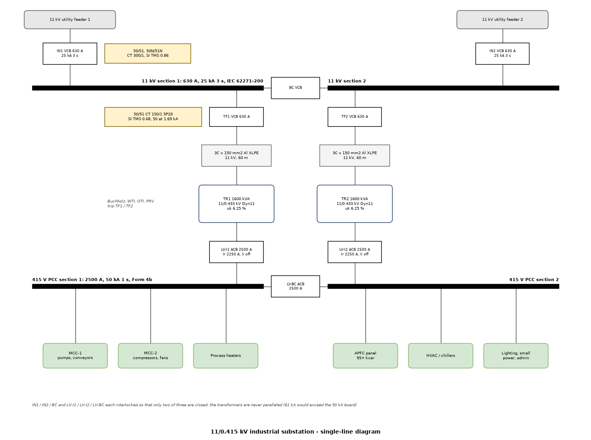
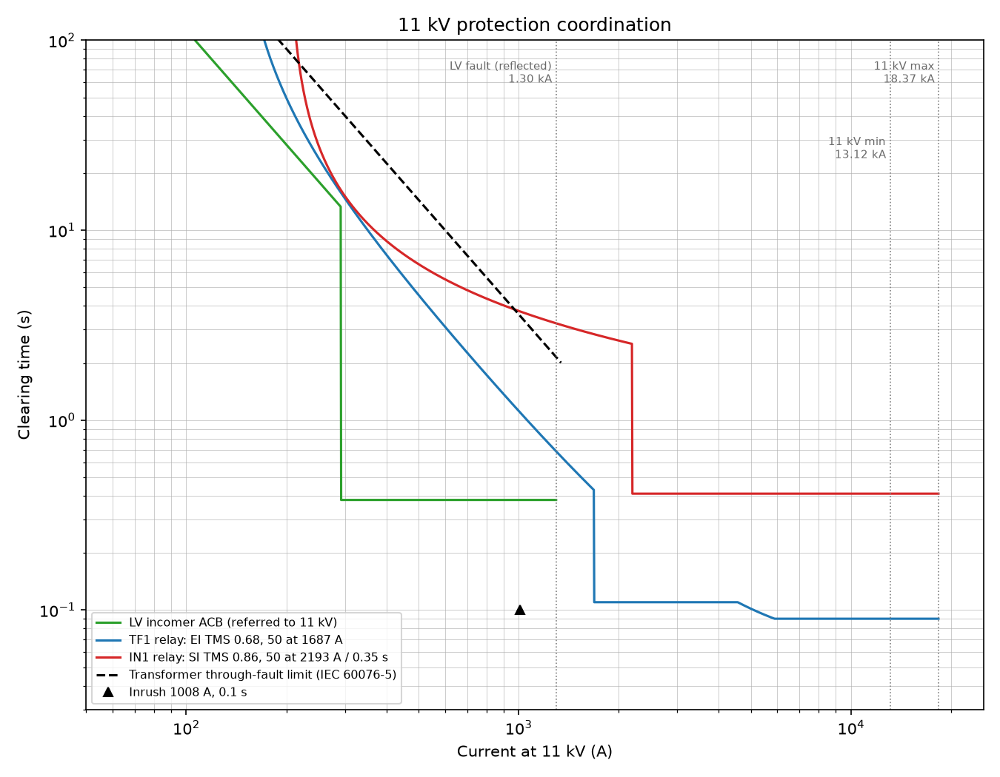

# 11 kV / 415 V Industrial Substation Design

Design of a double-ended 11/0.415 kV substation for a process plant, from the
load list to MV protection settings:

- load list and maximum demand
- transformer sizing, losses, regulation and motor-starting voltage dip
- fault levels at 11 kV and 415 V (IEC 60909), cross-checked with pandapower
- 11 kV VCB and LV ACB selection against those fault levels
- 11 kV cable sizing, governed by fault clearing time
- IDMT relay settings graded against the LV incomer over the full current range,
  with inrush, through-fault withstand and CT saturation checks



Two utility feeders supply a sectionalised 11 kV board. Each section feeds its
own 1600 kVA transformer and LV PCC section. Each transformer is sized for the
whole plant, so any one incomer or transformer can be out. On both boards only
two of the three breakers (two incomers and the bus coupler) can be closed at
once, so the transformers are never paralleled.

## Running

```bash
pip install -r requirements.txt
python study.py        # prints every table, writes results/
python -m pytest
```

`results/substation_design.xlsx` holds the load list, sizing, fault levels,
switchgear, cable, relay settings, grading and checks. The SLD is in
`results/sld.drawio` (editable) and `results/sld.png`.

## Load and transformer

| | |
|---|---|
| Installed load | 1768 kW (motors, heaters, HVAC, lighting) |
| Maximum demand | 1157 kW, 476 kvar, **1251 kVA** at pf 0.925 (diversity 0.9) |
| With 20 % growth | 1502 kVA |
| Transformer, each | **1600 kVA**, 11/0.433 kV, Dyn11, uk 6.25 % |
| Rated current | 84.0 A at 11 kV, 2226 A at 415 V |
| Loading | 78 % today, 94 % with growth |
| Efficiency / regulation at today's load | 99.02 % / 2.62 % |
| APFC to reach pf 0.95 | 95 kvar (see the APFC & harmonics project) |
| 160 kW compressor DOL start | 1731 A, **5.8 % dip** at the PCC with one transformer |

The transformer is sized on the demand before power factor correction, so the
plant still runs if the APFC panel is out of service.

## Fault levels

| Location | Ik (kA) | ip (kA) | pandapower Ik (kA) |
|---|---|---|---|
| 11 kV bus, max (350 MVA source) | 18.37 | 45.36 | 18.37 |
| 11 kV bus, min (250 MVA source) | 13.12 | 32.40 | 13.12 |
| 415 V PCC, one transformer, max | 32.96 | 76.46 | 32.96 |
| 415 V PCC, one transformer, min | 28.20 | 65.47 | 28.20 |
| 415 V PCC, both transformers paralleled | 61.20 | 142.58 | 61.20 |

The hand method and pandapower agree to four significant figures. Paralleling the
transformers would nearly double the LV fault level to 61 kA, beyond the 50 kA
board, which is why the 2-of-3 interlock is there.

## Switchgear

| Item | Selected | Check |
|---|---|---|
| 11 kV VCB | 12 kV, 630 A, **25 kA 3 s**, making 62.5 kA peak (IEC 62271-100) | Ik 18.37 kA, ip 45.4 kA; X/R 10 gives a 31.8 ms DC time constant, inside the standard 45 ms |
| 11 kV busbar | 630 A | one incomer carrying both transformers: 168 A |
| LV incomer and bus coupler ACB | 2500 A, Ir 2250 A, instantaneous off | transformer LV In 2226 A |
| LV PCC | 2500 A, **50 kA 1 s**, Icm 105 kA, Form 4b | Ik 33.0 kA, ip 76.5 kA |

## 11 kV cable

3-core Al XLPE (k = 94). The cable must survive the fault until the backup
protection clears it, which here means the incomer relay at 0.41 s:

| Size | Rating | S min, main protection (0.09 s) | S min, backup (0.41 s) | |
|---|---|---|---|---|
| 70 mm2 | 165 A | 59 mm2 | 125 mm2 | too small |
| 95 mm2 | 200 A | 59 mm2 | 125 mm2 | too small |
| 120 mm2 | 225 A | 59 mm2 | 125 mm2 | too small |
| **150 mm2** | 255 A | 59 mm2 | 125 mm2 | selected |

The load current is only 84 A. Fault withstand sets the size, and that depends
directly on how fast the 11 kV protection clears.

## 11 kV protection

| Relay | CT | 51 pickup | Curve | TMS | 50 stage |
|---|---|---|---|---|---|
| Transformer feeder TF1 | 150/1, 5P20 | 138 A | IEC extremely inverse | 0.68 | 1687 A, 0.05 s |
| 11 kV incomer IN1 | 300/1 | 202 A | IEC standard inverse | 0.86 | 2193 A, 0.35 s |

How the settings were reached:

1. **TF1 pickup** sits above the LV incomer's whole long-time pickup band
   (up to 1.2 x Ir, referred to 11 kV), so an LV overload is always left to the
   LV breaker.
2. **TF1 curve and TMS** are searched over SI, VI and EI. For each curve the lowest
   TMS is found that stays at least 0.3 s above the LV incomer **at every current**
   from its pickup up to the reflected LV fault (1297 A). SI cannot do this
   because its flat shape crosses the LV long-time curve. VI and EI both work, and
   EI gives the faster backup, so EI was chosen.
3. **TF1 high-set** is 1.3 x the reflected LV fault (1687 A). That keeps it out of
   reach of any LV fault, above the 1008 A magnetising inrush, and below the
   minimum 11 kV fault, so faults on the cable or HV winding clear in **0.09 s**.
4. **IN1** is graded the same way over TF1. A time-delayed 50 stage (0.35 s, one
   coordination interval behind TF1's high-set) clears 11 kV bus faults in
   **0.41 s**. With the IDMT curve alone it would have taken 1.33 s.

| Grading pair | Current at 11 kV | Downstream | Upstream | Margin |
|---|---|---|---|---|
| LV incomer ACB -> TF1 (worst point) | 1297 A | 0.38 s | 0.68 s | 0.30 s |
| TF1 -> IN1 (worst point) | 2207 A | 0.11 s | 0.41 s | 0.30 s |
| TF1 high-set -> IN1 at max 11 kV fault | 18370 A | 0.09 s | 0.41 s | 0.32 s |

| Check | Result |
|---|---|
| LV PCC fault cleared by the LV incomer / backed up by TF1 | 0.38 s / 0.68 s |
| Transformer through-fault withstand (IEC 60076-5, 2 s at its own Isc) | 2.15 s at this current, so backup is in time |
| TF1 high-set above inrush, above 1.3 x LV fault, below min 11 kV fault | yes, yes, yes |
| TF1 CT: effective ALF with 20 m of 2.5 mm2 leads | 69, linear to 10.3 kA, well above the 1.69 kA high-set |



Also fitted, not modelled here: earth-fault elements (50N/51N) on residual
current, which can be fast on TF1 because the delta HV winding does not pass
LV earth faults; plus the transformer's own Buchholz, winding and oil
temperature, and pressure relief trips to TF1/TF2.

## Assumptions

- 11 kV source 350 MVA maximum and 250 MVA minimum, R/X 0.1. These are the
  values to confirm with the utility.
- Transformer impedances and losses are typical IS 1180 / IEC 60076 values.
  Cable impedances and ratings are typical maker data for 11 kV Al XLPE.
- Relay operating time 30 ms minimum; VCB interrupting time 60 ms; coordination
  interval 0.3 s.
- The LV incomer ACB is modelled with long-time tr = 4 s at 6 Ir, short-time
  3 x Ir / 0.3 s, instantaneous off.
- Motor starting assumes 6.5 x FLC at pf 0.3 with only one transformer in
  service (the weaker case).

## Layout

```
substation/loads.py       load list and maximum demand
substation/network.py     equipment data, IEC 60909 fault calculation
substation/protection.py  IDMT relay, LV ACB and transformer limit models, grading search
substation/design.py      the design sequence
substation/pp_check.py    the same network in pandapower
substation/sld.py         single-line diagram (draw.io + PNG)
study.py                  runs everything, writes results/
```
